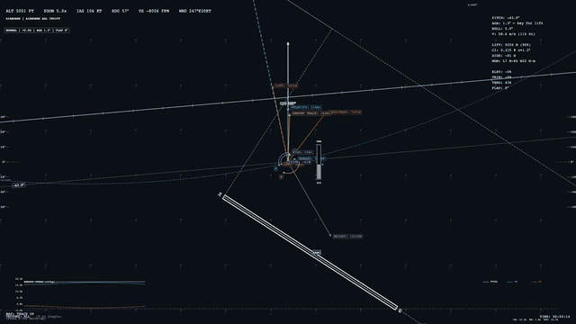
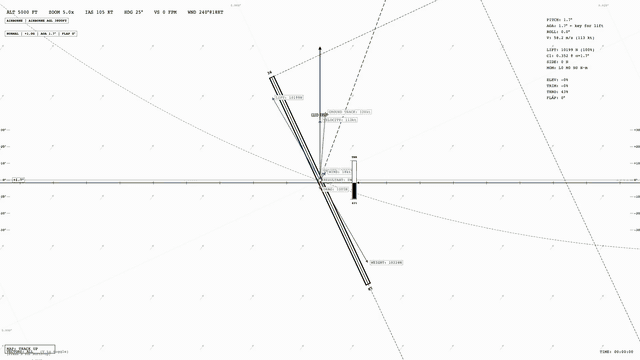
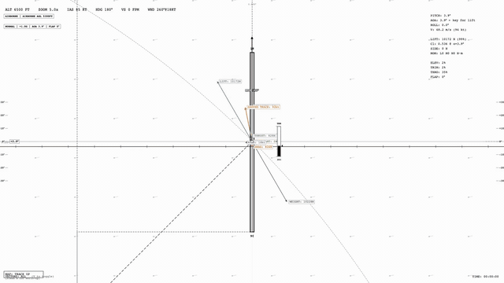
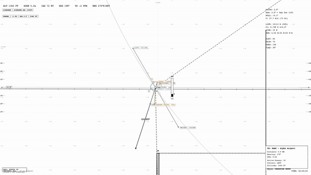

# Flight Simulator

A browser-based, six-degrees-of-freedom flight simulator where the physics are
the graphics. Fly a Cessna 172 using only the forces, velocities, navigation
geometry, and flight-state data acting on the aircraft—there is no conventional
outside view.

**[Fly the live simulator](https://stellan-flight-sim.netlify.app)**

## Demo films

The lightweight GIF previews play directly on GitHub. Click one—or use its
explicit link—to open the full-resolution, silent MP4 file.

| Force vectors | Map themes |
| --- | --- |
| [](https://raw.githubusercontent.com/stellan-s/flight-sim/main/media/demos/force-vectors.mp4) | [](https://raw.githubusercontent.com/stellan-s/flight-sim/main/media/demos/map-themes.mp4) |
| Lift, drag, thrust, weight, wind, velocity, and ground track become the aircraft's visual language. [Raw MP4](https://raw.githubusercontent.com/stellan-s/flight-sim/main/media/demos/force-vectors.mp4) | The same flight rendered across black-and-white, Nord, GitHub, Solarized, Dracula, and other palettes. [Raw MP4](https://raw.githubusercontent.com/stellan-s/flight-sim/main/media/demos/map-themes.mp4) |

| Flight envelope | Crosswind landing |
| --- | --- |
| [](https://raw.githubusercontent.com/stellan-s/flight-sim/main/media/demos/flight-envelope.mp4) | [](https://raw.githubusercontent.com/stellan-s/flight-sim/main/media/demos/crosswind-landing.mp4) |
| A compressed scenario moving from normal flight through overspeed, stall, spin, and recovery. [Raw MP4](https://raw.githubusercontent.com/stellan-s/flight-sim/main/media/demos/flight-envelope.mp4) | A scripted runway 18 approach in a fixed 270° at 18-knot crosswind, scored by the simulator. [Raw MP4](https://raw.githubusercontent.com/stellan-s/flight-sim/main/media/demos/crosswind-landing.mp4) |

## Features

- **Realistic Flight Dynamics**: Cessna 172 Skyhawk with authentic aerodynamics
  - 6DOF physics simulation with RK4 integration
  - Accurate lift, drag, and thrust calculations
  - Realistic control surfaces (elevator, aileron, rudder)
  - Elevator trim for hands-off flight

- **VOR Navigation**: Complete radio navigation system
  - Multiple VOR stations with realistic placement
  - DME (Distance Measuring Equipment) arcs
  - Radial visualization and course guidance
  - Morse code station identifiers with audio playback

- **Aviation Chart Rendering**: Professional-style navigation charts
  - 14 live themes, with black and white as the default
  - Paper, night, phosphor, amber, GitHub, Nord, Dracula, Solarized, Gruvbox,
    Tokyo Night, and Catppuccin palettes
  - Airport symbols with runway diagrams
  - Traffic pattern visualization (left/right patterns)
  - Obstacle markers
  - North-up and track-up modes

- **Dynamic Wind Model**: Realistic wind effects
  - Time-varying wind direction and speed
  - Wind velocity vectors displayed on chart
  - Groundspeed and drift calculations

- **Runway and Ground Operations**: Start, roll, rotate, land, and stop
  - Configurable airport and runway-end spawn at field elevation
  - Runway/grass rolling resistance, crosswind tire grip, steering, and wheel brakes
  - Force-based liftoff, touchdown bounce, landing grades, and crash thresholds
  - Live ground state plus a ground-reaction force vector

- **Persistent Configuration**: Keep a tuned simulator between sessions
  - Automatic browser-local restore for flight model, wind, display, and chart data
  - Named local presets plus portable JSON import/export
  - Landing history with score, sink rate, runway, and attitude

- **Force Vector Visualization**: Educational display of flight forces
  - Lift, drag, thrust, and weight vectors
  - Velocity, wind, and ground track vectors
  - Color-coded indicators (green=climbing, red=descending)

- **Flight Instruments**: Essential flight displays
  - Attitude indicator with horizon line
  - State vector panel with pitch, AOA, roll
  - Flight timer and controls display

- **Flight Envelope**: Stall, spin, damage, and recovery behavior
  - Angle-of-attack-based stall warning with audible horn
  - Progressive buffet, wing drop, autorotation, and spin entry
  - Overspeed and structural-load tracking

- **ASCII Interface**: Keyboard-first help and configuration screens
  - Monospaced terminal layout using the active map theme
  - Live editing of physics, aircraft, controls, wind, airports, runways, VORs,
    obstacles, ground handling, persistence, and display settings

## Project Structure

```
flight-sim/
├── index.html           # Main HTML file
├── README.md           # This file
├── media/
│   └── demos/                 # README GIF previews, posters, and MP4 films
├── data/
│   └── chart-features.json   # VORs, airports, obstacles
└── src/
    ├── main.js                # Entry point and game loop
    ├── config.js              # Configuration constants
    ├── core/                  # Physics simulation
    │   ├── aircraft.js        # Aircraft state and specs
    │   ├── flight-envelope.js # Stall, spin, damage, and recovery state
    │   ├── physics.js         # 6DOF physics engine (RK4)
    │   ├── forces.js          # Aerodynamic calculations
    │   ├── ground.js          # Runway contact and landing evaluation
    │   └── persistence.js     # Autosave, presets, import/export, history
    ├── navigation/            # Navigation systems
    │   ├── vor.js            # VOR navigation logic
    │   └── wind.js           # Dynamic wind model
    ├── controls/             # User input
    │   └── input.js          # Keyboard/mouse handler
    ├── audio/                # Sound systems
    │   ├── morse.js          # Morse code player
    │   └── stall-warning.js  # Angle-of-attack warning horn
    ├── rendering/            # Visualization
    │   ├── chart-themes.js   # Fourteen shared UI/map palettes
    │   ├── chart.js          # Navigation chart rendering
    │   ├── energy-diagram.js # Live energy history
    │   ├── instruments.js    # Flight instruments
    │   └── vectors.js        # Force/velocity vectors
    ├── ui/                   # ASCII help and configuration overlays
    │   ├── configuration-panel.js
    │   └── help-panel.js
    └── utils/                # Shared utilities
        ├── logger.js         # Debug logging
        ├── constants.js      # Physical constants
        ├── coordinates.js    # Frame transformations
        └── morse-data.js     # Morse code table
```

## Running Locally

The simulator uses native browser modules, so serve it over HTTP:

```bash
npm start
```

Then open [http://127.0.0.1:8765](http://127.0.0.1:8765).

## Testing

Run the dependency-free Node test suite:

```bash
npm test
```

Run tests plus JavaScript syntax validation:

```bash
npm run check
```

## Controls

### Flight Controls
- **Arrow Keys**: Pitch and roll control
  - ↑/↓: Elevator (pitch down/up)
  - ←/→: Aileron (roll left/right)
- **A/D**: Rudder (yaw left/right)
- **W/S**: Throttle (increase/decrease)
- **B**: Hold wheel brakes
- **Page Up/Down**: Elevator trim
- **Home**: Reset elevator trim

### Navigation
- **Right-click on VOR**: Tune VOR station (plays morse code)
- **Q/E**: Adjust OBS course ±10°
- **L / Shift+L**: Cycle airports / clear the airport selection

### View Controls
- **Mouse Wheel**: Zoom in/out
- **N/T**: Toggle map mode (North-up / Track-up)
- **1/2/3/4**: Select the 1×/3×/5×/10× zoom preset
- **V**: Cycle all, energy, and navigation vector overlays

### Simulation
- **P / Space**: Pause/resume simulation
- **H / ?**: Show/hide the help panel
- **C / Enter**: Open the full runtime configuration console

### Configuration Console

The configuration console pauses the simulation and exposes the live aircraft
state, force and moment gains, aerodynamic coefficients, airframe geometry,
controls, wind, ground handling, persistence, display settings, navigation data,
airports, runways, VORs, and obstacles.

- **Up / Down**: Select a parameter
- **Left / Right**: Switch parameter group
- **Plus / Minus**: Change the selected value
- **Alt + Plus / Minus**: Change by ten increments
- **Enter**: Type an exact number, edit text, toggle an option, or run an action
- **Page Up / Page Down**: Move eight rows
- **Home / End**: Jump to the first or last row
- **Escape / C**: Close the console and restore the previous pause state

Changes apply immediately to the running simulator. The `RETRIM` and `RESTART`
actions in the Session group let you settle the aircraft after changing the
flight model or apply edited initial conditions.

### Starting and persistence

The default session starts stationary on runway 18 at KABC. Apply power with W,
rotate with Arrow Down, and hold B to brake after reducing power with S. Start
mode, airport, runway end, ground friction, steering, rotation, and landing
thresholds are all editable in the `SESSION` and `GROUND OPS` groups.

When autosave is enabled, configuration changes are stored in browser-local
storage and restored on the next load. The `PERSISTENCE` group can save, load,
or delete named presets, download/upload a portable JSON configuration, and
inspect or clear the last 50 landing results. Aircraft position and active
flight progress are intentionally not restored; loading starts a fresh flight
using the restored configuration.

## Coordinate Systems

The simulator uses two primary coordinate systems:

### Earth Frame (NED - North-East-Down)
- **North**: Points towards true north
- **East**: Points towards east
- **Down**: Points towards center of earth
- Used for: Wind, navigation, chart display

### Body Frame
- **X**: Points forward (nose)
- **Y**: Points right (starboard wing)
- **Z**: Points down (through aircraft floor)
- Used for: Aerodynamic forces, control surfaces

Transformations between frames are handled in `src/utils/coordinates.js`.

## Configuration

All tunable parameters are in `src/config.js`:

- **Physics**: Timestep, initial conditions
- **Rendering**: Zoom levels, scales, UI positions
- **Visualization**: Force vector scales, colors
- **Debug**: Enable/disable logging

Example modifications:
```javascript
// Change initial conditions
INITIAL_ALTITUDE: 8000,  // Start at 8000 ft
INITIAL_SPEED: 120,      // Start at 120 knots

// Adjust force vector visibility
FORCE_VECTOR_SCALE: 0.03,  // Larger arrows

// Enable debug mode
DEBUG_MODE: true,
```

## Adding New Features

### Adding a New Airport

Edit `data/chart-features.json`:
```json
{
  "id": "KNEW",
  "name": "New Airport",
  "lat": 0.5,
  "lon": 0.5,
  "elevation": 2000,
  "runways": [
    {
      "id": "27/09",
      "heading": 270,
      "length": 5000,
      "width": 100,
      "surfaceType": "asphalt",
      "trafficPattern": {
        "side": "left",
        "altitude": 1000,
        "distance": 0.8
      }
    }
  ]
}
```

### Adding a New VOR Station

Edit `data/chart-features.json`:
```json
{
  "id": "NEW",
  "name": "New VOR",
  "lat": 0.3,
  "lon": -0.3,
  "frequency": "117.5"
}
```

The simulator will automatically:
- Display the VOR on the chart
- Enable right-click tuning
- Play morse code identification

### Modifying Physics

Key files:
- `src/core/forces.js`: Lift, drag, thrust calculations
- `src/core/aircraft.js`: Aircraft specifications (weight, wing area, etc.)
- `src/core/physics.js`: RK4 integration, state updates

### Adding New Instruments

1. Create rendering method in `src/rendering/instruments.js`
2. Call from `main.js` render loop
3. Access aircraft state via `state` parameter

## Development Tips

### Debug Mode

Enable in `src/config.js`:
```javascript
DEBUG_MODE: true,
```

Or toggle at runtime by modifying `main.js` to accept keyboard input.

### Understanding the Physics

The simulator uses:
- **RK4 Integration**: Fourth-order Runge-Kutta for accuracy
- **Body Frame Forces**: All aerodynamic forces calculated in aircraft body frame
- **State Vector**: [u, v, w, p, q, r, lat, lon, alt, φ, θ, ψ]
  - u, v, w: Velocity components (body frame)
  - p, q, r: Angular rates (body frame)
  - φ, θ, ψ: Roll, pitch, yaw (Euler angles)

### Common Modifications

**Change aircraft model**: Edit `src/core/aircraft.js` (mass, wing area, coefficients)

**Adjust wind**: Modify `src/navigation/wind.js` or change initial conditions in `main.js`

**Customize chart appearance**: Edit rendering methods in `src/rendering/chart.js`

**Add new force vectors**: Extend `src/rendering/vectors.js`

## Known Limitations

- No terrain mesh; airports use flat field elevations and all other terrain is flat
- Simplified aerodynamic model; ground effect is modeled, but wake turbulence is not
- No weather beyond wind (no thermals, clouds)
- Limited instrumentation (no full glass cockpit)

## Future Enhancements

Potential additions:
- Real map data (OpenStreetMap, FAA sectional charts)
- Multiple aircraft models
- ILS approach guidance
- ATC communication simulation
- Multiplayer capability
- Weather system (turbulence, icing)
- Engine failures and emergencies

## Technical Details

- **Language**: JavaScript (ES6 modules)
- **Rendering**: HTML5 Canvas 2D
- **Audio**: Web Audio API (morse identifiers and stall warning)
- **Physics**: Custom 6DOF implementation
- **No external dependencies**: Vanilla JavaScript

## License

This is a personal educational project. Feel free to modify and extend for learning purposes.

## Credits

Created as a flight simulation learning project featuring:
- Realistic Cessna 172 physics
- Professional aviation chart styling
- Educational force visualization
- Complete VOR navigation system

---

For questions or issues, refer to the code comments and JSDoc documentation throughout the source files.
